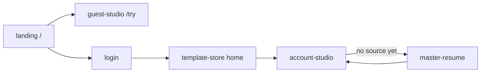

> **Type: PROJECT-SPECIFIC** | Canonical page catalog. Each kept page is one feature under `ai/project/features/<page-id>/FEATURE.md`.

# Opti pages

**Last updated:** 2026-10-16
**Status:** approved
**Surface:** Desktop-first. The same nine pages on phone. No second mobile product.

This is a page catalog, not an implementation plan. Backend stays as it is.

## Count

**9 user-facing pages.** Plus `/print/resume`, which is not a product page (PDF renderer only).

| Kind | Count | Pages |
|---|---|---|
| Marketing | 1 | Landing |
| Guest | 1 | Try |
| Logged-in | 3 | Template store, Studio, Master résumé |
| Auth | 4 | Login, Sign up, Forgot password, Reset password |
| Not a product page | 1 | Print résumé |

## Keep

Each row is one feature. Feature folder: `ai/project/features/<id>/`.

| ID | Route | Job |
|---|---|---|
| [landing](../features/landing/FEATURE.md) | `/` | Sell the product. Send guests to Try, accounts to Login / Sign up. Not the logged-in home. |
| [guest-studio](../features/guest-studio/FEATURE.md) | `/try` | Guest pastes résumé + job, tailors, previews, downloads. Skips the store. Default template Minimal. |
| [template-store](../features/template-store/FEATURE.md) | `/dashboard/templates` | Logged-in home. Browse layouts like a store, pick one, continue. Open even with no master résumé. |
| [account-studio](../features/account-studio/FEATURE.md) | `/dashboard/generator` | After a template is chosen. Job description, tailor, preview, PDF. Needs a master résumé only when they start tailoring. |
| [master-resume](../features/master-resume/FEATURE.md) | `/dashboard` | Quiet source editor. Create / edit / save the one stored résumé. Not the front door. |
| [login](../features/login/FEATURE.md) | `/login` | Sign in. Default destination: template store. |
| [signup](../features/signup/FEATURE.md) | `/signup` | Create account, verify email. |
| [forgot-password](../features/forgot-password/FEATURE.md) | `/forgot-password` | Request a reset link. |
| [reset-password](../features/reset-password/FEATURE.md) | `/reset-password` | Set a new password. |

**Not a feature page:** `/print/resume` — Chromium print target. Keep unlinked.

## Out now

Do not add these. Do not treat leftover chrome as pages.

- Guest template store — guests go to Try
- A setup page between store and studio
- Activity dashboard as home — `/dashboard` is the source résumé, not an overview
- Settings
- Billing
- `/resumes`, `/tailor`, `/tailored-resumes`, `/tailored-resumes/[id]`

## Later

Named, not a feature yet.

- History — list of previously tailored résumés, after results are stored

## Not pages

Unused shells. Ignore. Not features.

- `AuthenticatedAppShell`
- `AuthenticatedSidebar`
- `AccountHeader`
- `AccountGeneratorHeader`
- `AuthenticatedFooter`

## Stitch

Desktop designs for these nine pages live in Stitch project **Opti pages** (`12881320113014144798`), design system **Opti Horizon** (`assets/18192976405512321684`).

| Page | Stitch screen |
|---|---|
| landing | `screens/0344a263a61a4dd7b57fe47a6e55ad02` |
| guest-studio | `screens/6220ca199f2c482d96a78d425e26b68c` |
| template-store | `screens/f2812737b72d421eb39aeb57c30fada2` |
| account-studio | `screens/8973486ef5724405ab4915a395f068c5` |
| master-resume | `screens/580b75a5c8764a8a8b8f7270a2199fb7` |
| login | `screens/20f9b802f2c742fa95ee75b5115bf4d5` |
| signup | `screens/d0a34933a6754b5ea72ee0174d9eefc2` |
| forgot-password | `screens/db87250e84bf4ac19074433dab3d252c` |
| reset-password | `screens/0f5146635cdc4f77bb4c498f9fce6878` |

## Rules

- One route, one job. If two jobs fight, they are two pages.
- Phone uses the same nine pages. No mobile-only routes.
- A missing master résumé does not hide the store. It only stops the account studio until the source exists.
